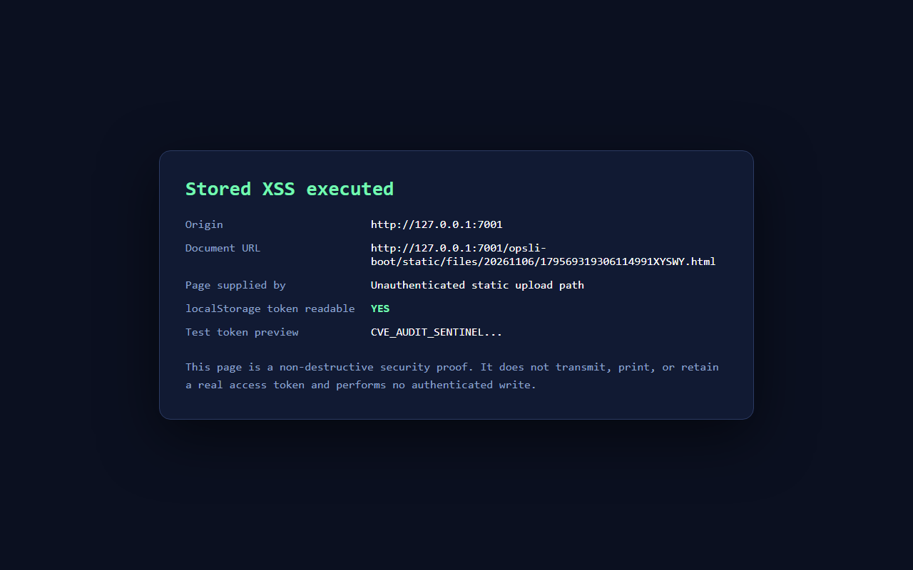

# OPSLI HTML Upload Stored XSS — CVE Evidence

## Record

- Product: `hiparker/opsli-boot`
- Version: `2.2`
- Backend revision:
  `603d8a6ad001e91d265543259a357f8134c45549`
- Official frontend revision:
  `2c98b5249fa82ee2d0210e101ffd0b71036ac8dc`
- Test date: `2026-11-06`
- Test environment: isolated local database, Redis DB 15, JDK 21
- Uploader identity: `songyi`
- Uploader super administrator: `false`

## Finding

`opsli-boot` 2.2 accepts an HTML file through the authenticated OSS upload
endpoint. In local-storage mode, the generated file is placed under
`/static/files/`, is retrievable without authentication, and is returned as
`Content-Type: text/html`.

The uploaded document executes JavaScript in the application's origin. The
official UI stores its access token in `localStorage["opsli-token"]`, so
same-origin JavaScript can read the token of a user who opens the uploaded URL
and can use that user's permissions when calling application APIs.

## Verified result

The low-privilege account `songyi` was not a super administrator:

```json
{
  "username": "songyi",
  "super_admin": false
}
```

It uploaded the following harmless HTML proof:

```text
http://127.0.0.1:7001/opsli-boot/static/files/20261106/179569319306114991XYSWY.html
```

A fresh HTTP client with no cookies and no `T-Authorization` header retrieved
the file successfully:

```http
HTTP/1.1 200
Content-Type: text/html
X-Content-Type-Options: nosniff
Content-Length: 2479
```

The browser execution result was:

```json
{
  "executed": true,
  "origin": "http://127.0.0.1:7001",
  "tokenReadable": true,
  "tokenLength": 27
}
```

The 27-character value was the fixed, non-sensitive test marker
`CVE_AUDIT_SENTINEL_20261106`. No real token was transmitted or stored.



## Reproduction

Prerequisites:

- The application uses local object storage.
- `/static/files/**` remains anonymously accessible.
- A valid low-privilege application account exists.

Run:

```powershell
python -m pip install -r requirements.txt

$env:OPSLI_URL = "http://127.0.0.1:7001/opsli-boot"
$env:OPSLI_USER = "songyi"
$env:OPSLI_PASS = "<test-account-password>"
python .\exp_upload_xss.py --output .\evidence.json
```

The test passes only when:

- the tested account is not a super administrator;
- the upload endpoint returns a `fileStoragePath`;
- a new unauthenticated session receives HTTP 200;
- the anonymous response has `Content-Type: text/html`;
- the proof marker is present in the anonymous response.

## What the evidence proves

- A low-privilege authenticated user can upload active HTML.
- The resulting file is anonymously retrievable.
- The server serves the uploaded file as `text/html`.
- JavaScript in the uploaded file executes in the application origin.
- Same-origin JavaScript can read the official UI's localStorage token key.

## Conditions and limitations

- Local object storage must be enabled. Third-party object storage changes the
  origin relationship and may remove the same-origin XSS condition.
- A victim must open the generated uploaded-file URL in a browser.
- Token takeover requires the victim to have a token in
  `localStorage["opsli-token"]`, as used by the official frontend.
- The proof demonstrates token readability and execution. It deliberately does
  not exfiltrate a real token or perform an authenticated write.

## Classification

- Primary: CWE-434, Unrestricted Upload of File with Dangerous Type
- Secondary: CWE-79, Stored Cross-site Scripting

CVSS 4.0:

```text
CVSS:4.0/AV:N/AC:L/AT:N/PR:L/UI:P/VC:H/VI:H/VA:N/SC:N/SI:N/SA:N
```

Base score: **8.5 High**

## Relevant source code

- Upload has no content-type or dangerous-extension validation:
  <https://github.com/hiparker/opsli-boot/blob/603d8a6ad001e91d265543259a357f8134c45549/opsli-modulars/opsli-modulars-system/src/main/java/org/opsli/modulars/tools/oss/web/OssRestController.java#L41-L64>
- Original suffix is retained:
  <https://github.com/hiparker/opsli-boot/blob/603d8a6ad001e91d265543259a357f8134c45549/opsli-base-support/opsli-core/src/main/java/org/opsli/plugins/oss/service/BaseOssStorageService.java#L77-L107>
- Local upload writes beneath `/static/files/`:
  <https://github.com/hiparker/opsli-boot/blob/603d8a6ad001e91d265543259a357f8134c45549/opsli-base-support/opsli-core/src/main/java/org/opsli/plugins/oss/service/impl/LocalStorageServiceImpl.java#L117-L167>
- Static storage and authentication exception:
  <https://github.com/hiparker/opsli-boot/blob/603d8a6ad001e91d265543259a357f8134c45549/opsli-starter/src/main/resources/application.yaml#L57>
  <https://github.com/hiparker/opsli-boot/blob/603d8a6ad001e91d265543259a357f8134c45549/opsli-starter/src/main/resources/application.yaml#L195>
  <https://github.com/hiparker/opsli-boot/blob/603d8a6ad001e91d265543259a357f8134c45549/opsli-starter/src/main/resources/application.yaml#L205>
- Official UI token storage:
  <https://github.com/hiparker/opsli-ui/blob/2c98b5249fa82ee2d0210e101ffd0b71036ac8dc/vue-admin-better/src/config/setting.config.js#L37-L42>
  <https://github.com/hiparker/opsli-ui/blob/2c98b5249fa82ee2d0210e101ffd0b71036ac8dc/vue-admin-better/src/utils/accessToken.js#L31-L45>

## Remediation

Reject HTML, XHTML, SVG, and other active document types using both extension
and MIME/content inspection. Store uploads on a separate origin, require an
explicit upload permission, and serve untrusted files with
`Content-Disposition: attachment` and a non-document MIME type.
